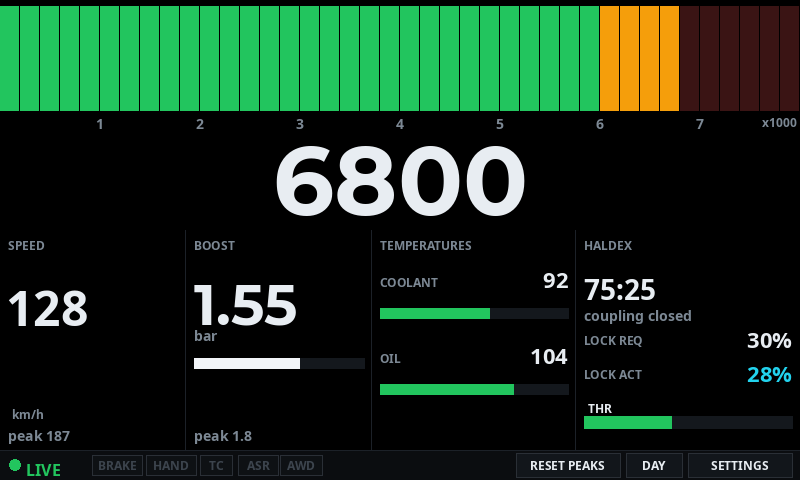

# OpenHaldex S3 Dash

A native dashboard for the **[OpenHaldex](#credits)** Haldex AWD controller,
running directly on a **7" ESP32-S3 touch panel**. It replaces the browser
dashboard — `dash.html`, served by the controller itself — with standalone
firmware, so the display boots straight to the gauge in the car. No phone, no
tablet, no browser, no WiFi client to keep awake.

The controller firmware is **not modified**. This project only reads what the
controller already publishes, so it can keep taking upstream updates.

> ### ⚠️ 100% AI-generated project
>
> Every line of this repository — firmware, build scripts, mock-ups and
> documentation — was written by **goose**, an open-source AI coding agent.
> Nothing here was typed by hand. The human role was direction, design
> approval, hardware bring-up and testing in the car.
>
> Treat it accordingly: it was built against one specific board (a CrowPanel
> 7.0" ESP32-S3), it is not security-audited, and the API it consumes is a
> hobby project's own. Read the code before you flash it.

---

## Credits

**[OpenHaldex](https://github.com/Forbes-Automotive/OpenHaldex-C6)** is an
open-source Haldex AWD controller for Volkswagen and Audi Group Gen1, Gen2 and
Gen4 differentials, built by **[Forbes Automotive](https://forbes-automotive.com)**.

Everything this dashboard displays originates there. The CAN decoding, the
Haldex control logic, the HTTP API and the ESP-NOW broadcast are all the
OpenHaldex-C6's work — this repository is only a **display client** for it.

If you are looking for the controller rather than a display for it, that is
the project you want.

The two sides communicate using interfaces the C6 already exposed, so neither
needed changing: `include/ohx_proto.h` here is a **verbatim copy** of the
controller's shared wire-format header (taken from `b54d9a1d`). Refresh it
from upstream; never edit it.

---

## 1. What it shows



*Mock-up at the panel's real 800x480 geometry — `tools/mockup_dash.py` draws it.*

| Band | Contents |
|---|---|
| Rev bar | One segmented bar across the full 800 px, `1`–`7` above it and `x1000` at the right, then the rpm as a large centred number on its own row |
| Tiles | `SPEED` (km/h + peak) · `BOOST` (value, unit, a bar, peak) · `TEMPERATURES` (coolant and oil, each with a bar) · `HALDEX` (mode, coupling state, lock requested / actual, throttle) |
| Status bar | Data-state dot, the BRAKE / HAND / TC / ASR / AWD lamps, rpm peak, and the RESET PEAKS / DAY / SETTINGS buttons |

The tile band follows the same geometry as the browser page, from one unit:

```
u = min(width / 100, height / 56)         ->  8 px at 800x480
```

REVS is the only full-width item; everything else is a tile, so no value
appears twice.

**Unmeasurable values show `--`, never a fake zero.** A JSON `null` from the
controller is carried all the way to the screen as "unknown", with a dash
(`NaN`) as the sentinel. Only the dash glyph draws `--`; a genuine `0` draws
`0`.

**Staleness moves the status light, not the data.** When live data stops
arriving the dashboard keeps the last values it had — bars stop where they
were, tiles keep their numbers — and the status dot turns amber with `STALE`.
Before the first sample ever arrives it reads `WAIT`, and `NO WIFI` in red if
the link itself is down. Nothing is blanked and no overlay covers the screen.

**Design choices specific to this display:**

* The status bar is **30 px** rather than the page's `2.8u` (22 px), so the
  buttons are a usable touch target. The band above absorbs the difference.
* **Long-press anywhere on the top band opens Settings**, because the
  status-bar buttons are small to hit in a moving car.
* Boost, speed and rpm are drawn with the *eased* value — a 110 ms time
  constant, matching the page — so they sweep rather than snap.
* Settings holds every threshold, the units, the brightness and the
  connection, and is stored in NVS so it survives a power cycle.

---

## 2. Hardware

| | |
|---|---|
| Board | Elecrow **CrowPanel 7.0"** HMI, `ESP32 Display-7.0` |
| MCU | ESP32-S3 QFN56 rev v0.2, dual core @ 240 MHz |
| PSRAM | 8 MB **OPI** (octal) — mandatory, see §5 |
| Flash | 4 MB quad |
| Panel | 800x480 RGB565 parallel (16 data lines + DE/VSYNC/HSYNC/PCLK) |
| Touch | GT911 capacitive, I2C on SDA 19 / SCL 20 at 400 kHz |
| Expander | PCA9557 I2C: IO0 = panel reset, IO1 = input |
| Backlight | GPIO 2 |
| USB | CH340 UART bridge (`/dev/ttyUSB0`), 460800 baud ceiling |

Nothing about the firmware is board-specific beyond `include/board_config.h`,
which holds the pin map, panel timings, I2C pins and the expander.

### The 5.0" variant

The CrowPanel **5.0"** uses the *same* 16 GPIOs but wired to the panel's RGB
inputs in a **different order**, and swaps DE/VSYNC. Building for it is one
flag:

```ini
build_flags = -DDASH_USE_50_PINMAP=1
```

A wrong pin map shows up immediately as a garbled or colour-swapped image. It
damages nothing.

### Touch axes

The GT911 library's `ROTATION_NORMAL` returns `(width - x, height - y)` — it
mirrors *both* axes — which puts every press 180° from the finger. This build
sets `ROTATION_INVERTED`, and the console's `r` key cycles the four mappings
if a differently-mounted panel needs another one.

---

## 3. Data flow

Two transports feed the dashboard. **ESP-NOW is the primary** — the
controller broadcasts a packed status packet every 100 ms with no web stack
involved, so there is no association, no socket and no TCP in that path. HTTP
is the fallback, and it still carries the fields the packet does not have.

```
        core 0                                 core 1
+-----------------------------+        +---------------------------+
| "ohxnet" task               |        | loop()                    |
|   WiFi STA -> C6 HTTP API   | struct |   ui::tick()     ~30 Hz   |
|   GET /api/live       1 Hz  | --+    |   feed::poll()            |
|   GET /api/dashboard  1 Hz  |   |    |   lv_timer_handler()      |
| ESP-NOW receive (radio, no  |   +--> |---------------------------|
|   association, no sockets)  |        | net/datafeed.cpp: choose  |
+-----------------------------+        |   source, merge fields    |
      ^  ~10 Hz, no HTTP              | LVGL -> 2x 800x480 PSRAM  |
      |                               | frame buffers -> RGB DMA  |
   C6 broadcasts OHX_STATUS           +---------------------------+
   to FF:FF:FF:FF:FF:FF
```

`src/net/datafeed.{h,cpp}` is the single place that decides provenance:

| Field | Source |
|---|---|
| `rpm`, `speed`, `throttle`, `boost`, `lockTarget`, `lockActual`, `oil` | ESP-NOW while packets arrive (holds 500 ms), else HTTP |
| `mode`, `haldexState`, `chassisCAN`, `haldexCAN`, `brakeIn`, `handbrakeIn`, `couplingOpen`, `tempProtection` | ESP-NOW — the packet has real bits for all of these |
| `coolant` | always HTTP — the packet has no coolant field |
| `tcOn`, `asrOn`, `awdWarning` | always HTTP — the packet carries `TC_FORCE` / `ASR_OFF` (off flags), which are not the same thing |
| packets stopped | everything falls back to HTTP, and says so on the console |

A numeric field the packet marks as "no data" falls back to the HTTP value if
HTTP has one, so a field this Haldex generation never fills in cannot make the
dashboard worse than it was. The source in use is printed in the stats line
and on every change (`[feed] values now come from esp-now`), and `e` on the
console dumps both transports side by side.

| Endpoint | Rate | Fields used |
|---|---|---|
| `/api/live` | 1000 ms | `coolantTemp` — and everything, if the packets stop |
| `/api/dashboard` | 1000 ms | `tcOn`, `asrOn`, `awdWarning` — and everything, if the packets stop |

Because ESP-NOW needs no association, the dashboard goes **LIVE before the
WiFi join completes** — `[ui] LIVE (data age 21 ms, source esp-now)` while
`http down`.

### Why HTTP is still there

Three reasons, all deliberate: coolant temperature is not in the packet; the
three lamps above are not in it with matching semantics; and if the controller
stops broadcasting (older firmware, ESP-NOW disabled, out of range) the
dashboard keeps working at 1 Hz instead of going dark.

### Why two poll rates

`/api/dashboard` on the controller calls `getCPUUsagePercent()`, which mallocs
and walks every task on the controller's **single** core. Polling that faster
buys no extra visual resolution. Splitting fast and slow data keeps the same
look for roughly 90 % less CPU on the controller.

`/api/dashboard` is also never polled slower than **2 s**: it is the only
handler that calls `otaNoteWebActivity()`, and the controller drops its access
point after about five minutes without it. The settings page clamps
`pollDashMs` to 250..2000 ms for exactly this reason.

### Joining the controller's access point

The OpenHaldex-C6 publishes an **open** access point by default, which two
defaults in the Arduino core have to be worked around:

* `WiFi.setMinSecurity(WIFI_AUTH_WPA2_PSK)` is the core's default, so an open
  network is *below* the threshold. The station is therefore told
  `WIFI_AUTH_OPEN` before `WiFi.begin()`.
* Association and DHCP are separate problems. The board associates fine and
  then never gets a lease, which looks identical to "AP is dead" from outside.
  The cause is that the controller is usually *also* on a home LAN already
  using `192.168.1.0/24` — its softAP and station interfaces then share a
  subnet, and its DHCP server cannot hand out an address that looks free. The
  firmware logs `associated but no DHCP lease` and retries with a static
  address derived from the configured host (`192.168.1.203`), skipping DHCP
  entirely. That suits a fixed install: the dash talks to one AP at one
  address.

The join loop prints BSSID, channel and RSSI, which only read back once the
station is associated, so the two failure modes can be told apart.

### Connection reuse

Both pollers use `HTTPClient::setReuse(true)`, so the two requests per second
share one TCP connection instead of opening two. That matters: the controller
runs with `CONFIG_LWIP_MAX_SOCKETS=8`, and a handshake-per-request pattern
would fill its socket table with `TIME_WAIT` entries.

---

## 4. Build

```bash
cd OpenHaldex-S3-Dash
./.venv/bin/pio run -e s3-dash
```

The plan is a plain [PlatformIO](https://platformio.org) project. The first
build downloads the pioarduino `espressif32@55.3.312` platform — the same
release the OpenHaldex-C6 firmware uses, so both projects build against an
identical toolchain — plus the framework, which takes a few minutes, once.

**If the platform disappears on the first build**, the installed PlatformIO
core is reporting itself as a post-release of 6.2.0 (`6.2.0.post1`), which
PlatformIO turns into the semver *pre-release* `6.2.0-post.1`. The platform
declares `engines >= 6.2.0`, the pre-release fails that test, and Platform
Manager deletes the platform — leaving `~/.platformio/platforms` empty and a
build log that ends with `IncompatiblePlatform`. The core is a post-release,
not a pre-release, so report it as plain 6.2.0: in `platformio/__init__.py`,
set

```python
VERSION = (6, 2, 0)
```

**PSRAM must be OPI.** The panel driver needs two 800x480x16 bpp frame buffers
(1.50 MB) reachable by the LCD DMA engine. `platformio.ini` sets
`board_build.arduino.memory_type = qio_opi`; without it `lcd.begin()` fails
and nothing is drawn.

### Flash

```bash
# with the board in download mode:
./.venv/bin/pio run -e s3-dash -t upload
```

`upload_speed` is pinned to **460800**. The CH340 on this board fails at
921600 with `Invalid SLIP escape (0xdb, 0xBD)`.

---

## 5. Before you flash: back up the board

The CrowPanel ships with a factory application. Reading the flash is
read-only and risk-free, and it is worth having:

```bash
./.venv/bin/esptool -p /dev/ttyUSB0 -b 460800 read_flash 0x0 0x400000 \
    .backup/s3_factory_full_4MB.bin
```

Restore the original image at any time with:

```bash
./.venv/bin/esptool -p /dev/ttyUSB0 -b 460800 write_flash 0x0 \
    .backup/s3_factory_full_4MB.bin
```

The board's factory partition table, as read from that image:

| Label | Type | Offset | Size |
|---|---|---|---|
| nvs | data/nvs | 0x9000 | 0x5000 |
| otadata | data/ota | 0xe000 | 0x2000 |
| app0 | app/ota_0 | 0x10000 | 0x3c0000 |
| spiffs | data/spiffs | 0x3d0000 | 0x20000 |
| coredump | data/coredump | 0x3f0000 | 0x10000 |

This firmware replaces it with `partitions_4mb_ota.csv`, which trades app size
for **two app slots (OTA)**, a 128 KB LittleFS partition and a coredump
partition:

| Label | Type | Offset | Size |
|---|---|---|---|
| nvs | data/nvs | 0x9000 | 0x5000 |
| otadata | data/ota | 0xe000 | 0x2000 |
| app0 | app/ota_0 | 0x10000 | 0x1e0000 |
| app1 | app/ota_1 | 0x1f0000 | 0x1e0000 |
| littlefs | data/spiffs | 0x3d0000 | 0x20000 |
| coredump | data/coredump | 0x3f0000 | 0x10000 |

OTA matters once the dash is mounted behind the dashboard, where there is no
USB cable.

---

## 6. Configuration

Defaults match the browser page:

| Setting | Default |
|---|---|
| SSID / password | `OpenHaldex-C6` / *(empty — the controller's AP is open by default)* |
| Host | `192.168.1.1` (the access-point address; `openhaldex.local` also works) |
| rpm max / amber / redline / shift | 8000 / 6000 / 6800 / 7300 |
| Coolant warn / crit (C) | 100 / 110 |
| Oil warn / crit (C) | 120 / 135 |
| Boost max / warn / crit (mbar gauge) | 2500 / 1800 / 2200 |
| Temperature / boost units | C / bar |
| Poll live / dash / stale | 1000 / 1000 / 1500 ms |

All of it is editable on the device's Settings page and stored in NVS
(`Preferences`, namespace `ohxdash`) as one versioned blob, so a firmware
update that changes the struct layout falls back to defaults instead of
reading garbage.

**No credentials are in git.** For bench work, copy
`include/wifi_secrets.h.example` to `include/wifi_secrets.h` (gitignored) and
fill it in. It is only a first-boot seed — the settings page always wins
afterwards.

### Units

Boost is **millibar gauge** (above ambient). The controller decodes both MQB
`Ladedruck` (0x107) and PQ (0x588) as `(raw * 10) - 1000` and clamps to
`>= 0`, so 1000 mbar ≈ 1.00 bar ≈ 14.5 psi.

---

## 7. Display tuning

The RGB panel configuration in `src/hal/crowpanel.cpp` is Elecrow's own 7.0"
description. Symptoms and where to look if a board is reworked or is a
different revision:

| Symptom | Fix |
|---|---|
| Colours swapped (red shows as blue) | build with `-DDASH_USE_50_PINMAP=1`, or permute `kDataPins` |
| Image shifted / wrapped | `LCD_HSYNC_*` / `LCD_VSYNC_*` porches in `board_config.h` |
| Whole image jitters / shifts | panel DMA starved of PSRAM bandwidth: raise `LCD_BOUNCE_LINES`, then lower `LCD_PCLK_HZ` |
| Image tears or rolls | LVGL is drawing into the buffer being scanned: keep `LCD_USE_DOUBLE_FB 1` and `LV_DISPLAY_RENDER_MODE_DIRECT` |
| Panel blank, no backlight | the PCA9557 was not found — check the I2C scan line in the boot log |

### The real limit is PSRAM bandwidth

Whatever else is tuned, this is the number that decides how the dash behaves.
The panel reads its frame buffer out of PSRAM continuously, and this board
measures only ~35–44 MB/s in total, with ~19 MB/s of that left for the CPU
while the panel is scanning:

| pclk | refresh | panel needs |
|---|---|---|
| 24 MHz | 49 Hz | 37.9 MB/s — starves everything else |
| 20 MHz | 41 Hz | 31.6 MB/s |
| **16 MHz** | **33 Hz** | **25.3 MB/s — what this build uses** |
| 12 MHz | 24.6 Hz | 19.0 MB/s |

Two things make it worse. WiFi's buffers are allocated in PSRAM
(`CONFIG_SPIRAM_TRY_ALLOCATE_WIFI_LWIP=y`, baked into the prebuilt IDF
libraries), so network traffic competes with the panel directly — pausing the
HTTP polling alone took the render rate from 16 fps to 42 fps on the bench.

Symptoms are easy to misread: with a starved DMA the whole image rolls, which
looks like a badly tuned television rather than a software bug.

### Two frame buffers, and DIRECT mode

LVGL renders into one full-screen PSRAM buffer while the RGB peripheral scans
the other, and `esp_lcd_panel_draw_bitmap()` only returns once the swap has
happened at a frame boundary — so a frame is never half old and half new.

The render mode that pairs with it is **DIRECT**: a full-screen buffer, but
only the invalidated rectangles are drawn.
`LV_DISPLAY_RENDER_MODE_FULL` looks tempting but forces a whole 800x480 render
*and* a 768 KB PSRAM write every frame, which both wastes the CPU and starves
the panel.

When the DMA's prefetch falls behind, the peripheral loses sync with the DMA
and the picture shifts. Espressif ships `esp_lcd_rgb_panel_restart()` for it
and `CONFIG_LCD_RGB_RESTART_IN_VSYNC` is enabled in this build, which turns a
permanent shift into a jitter. `LCD_BOUNCE_LINES` is the margin against that:
the driver refills an internal-SRAM bounce buffer from PSRAM in bursts, and
the deeper it is, the longer a WiFi burst can run without emptying it. Two of
them are allocated, so 16 lines costs 2 x 25 600 B.

The pixel clock is taken from **PLL_D2 (240 MHz)**, which divides to 24 MHz by
an exact 10. On `PLL_F160M` the same 24 MHz needs the fractional divider
6 + 2/3; the exact divider removes any clock jitter from the picture. The
source is printed at boot, and `p` on the serial console steps the clock down
24 → 20 → 16 → 12 MHz at runtime to test the bandwidth theory live.

### Where the layout lives

Bar cell size, the big number's row, tile widths and padding are all derived
in `include/theme.h`, so geometry is adjusted in one place. The reasoning
behind the top band is in `docs/redesign-bars.md`, and the mock-up tool that
draws the layout at panel size before it is coded is `tools/mockup_dash.py`.

---

## 8. Serial console

115200 baud on UART0 (the CH340). Besides the boot banner:

| Key | Effect |
|---|---|
| `1`..`5` | toggle redraw groups: rev bar, tick numbers, big number, tile readouts, status bar |
| `0` / `9` | all redraw groups on / off |
| `p` | step the pixel clock down one notch |
| `d` | print the frame buffer the panel is scanning as an ASCII luminance map |
| `n` | pause / resume the HTTP polling |
| `e` | ESP-NOW vs HTTP, every field side by side |
| `E` | enable / disable the ESP-NOW listener (A/B its cost on one boot) |
| `b` | toggle the bounce buffer between 0 and 16 lines |
| `r` | try the next GT911 axis mapping |
| `t` | reset the touch probe |
| `h` | the list above |

`d` is the bench substitute for a camera: `tools/serial_cmd.py d 34` prints
what is on the glass, which is how the layout was verified without a screen in
front of you. `tools/serial_seq.py "35:d,42:n,48:d,56:n"` drives a whole timed
scene in one run.

To stage a **stale** screen, both transports have to be stopped — `E` (stop
listening) then `n` (stop polling). Either one alone leaves the dashboard live,
which is the point of the fallback; `[stats] source ...` says which one is
carrying it.

> Opening this board's serial port pulses the auto-reset lines and reboots the
> ESP32, clearing anything held in RAM. `tools/serial_watch.py` reads the
> console without resetting, and `tools/serial_shell.py` holds the port open so
> gestures and console keys can be interleaved with no reset in between.

---

## 9. ESP-NOW

The controller broadcasts a packed `OhxStatus` struct to the broadcast address
every 100 ms with **no web stack involved** — no access-point association, no
sockets, no HTTP. This firmware listens to it and it carries the numbers on the
glass; HTTP stays for coolant temperature, for the three lamps the packet has
no matching flag for, and as the fallback if the packets stop.

| | |
|---|---|
| Wire format | `include/ohx_proto.h`, a **verbatim copy** of the controller's shared header (`b54d9a1d`). Refresh it from upstream; never edit it. |
| Listener | `src/net/ohx_now.{h,cpp}` — init, receive callback, decode, counters |
| Source choice | `src/net/datafeed.{h,cpp}` — ESP-NOW while packets arrive, HTTP otherwise |
| Build switch | `-DOHX_USE_ESP_NOW=1`; `0` compiles a build that only ever uses HTTP, and the listener is not initialised at all |
| Console | `e` = every field, ESP-NOW beside HTTP. `E` = enable/disable the listener at runtime |
| Stats | `[stats] source esp-now (packet age 27 ms, http up)` and `[stats] esp-now 418 pkt (9.7 Hz), rej 0 dup 0 gap 3, ch 1, rssi -33 dBm` |
| Every change | `[feed] values now come from esp-now` / `... from http` |

84-byte packets arrive at 9.7–10.6 Hz with 0 rejects and ~0.5 % sequence gaps
— broadcast has no retransmission, so gaps are expected. Listening costs
nothing in render rate: the loop stays at ~60.2 ms busy out of a 61.0 ms
period with the listener on or off.

In the car, `e` is the cross-check that matters: it prints both transports
field by field, so any field whose scaling differs — `boost` is the one to
watch, since the packet documents it as "mbar above ambient" — is visible
rather than guessed at.

Full plan, risks and phase notes: [`docs/esp-now-plan.md`](docs/esp-now-plan.md).

---

## 10. What this device cannot show

Data the controller does not expose, or has no room for here:

* Engine oil **pressure**, fuel pressure, individual wheel speeds.
* Gear position and clutch state.
* Battery voltage — this *is* available, but only in the ESP-NOW broadcast
  (`supplyMv`), not over HTTP. The dash receives it; it has no space on the
  layout yet.
* Anything at all while the chassis CAN is silent: on the bench with no
  vehicle, the controller reports `rpm`/`speed`/`throttle`/`boost` as JSON
  `null`, and this firmware correctly shows `--`.

---

## 11. Repository layout

```
platformio.ini              build: ESP32-S3, OPI PSRAM, 4 MB OTA layout
partitions_4mb_ota.csv      two app slots + LittleFS + coredump

include/
  board_config.h            panel pins, timing, I2C, expander, touch
  theme.h                   palette, fonts, all layout constants
  lv_conf.h                 LVGL v9 config (partial; defaults fill the rest)
  ohx_proto.h               ESP-NOW wire format - verbatim copy of the
                            controller's shared header; refresh, never edit
  wifi_secrets.h.example    optional bench credentials

src/
  main.cpp                  boot banner, loop: ui tick + lv_timer_handler
  hal/
    crowpanel.h/.cpp        RGB panel, LVGL display+indev, backlight, touch
    pca9557.h/.cpp          expander driver + I2C probe
  net/
    telemetry.h/.cpp        WiFi + /api/live + /api/dashboard, core 0 task
    ohx_now.h/.cpp          ESP-NOW listener: decode + counters
    datafeed.h/.cpp         source selection: ESP-NOW packets vs HTTP
  app/
    config.h/.cpp           NVS-backed settings, validation, revision counter
  ui/
    dash_ui.h/.cpp          the whole dashboard in LVGL
    fonts/
      font_rpm_96.c         96 px rev digits, generated (tools/make_fonts.sh)
      font_num_56.c         56 px boost value, generated

tools/
  make_fonts.sh             regenerate src/ui/fonts from tools/fonts/*.ttf
  mockup_dash.py            draw the layout at panel size before coding it
  serial_capture.py         reset + read the console (read-only)
  serial_watch.py           read the console without resetting the board
  serial_shell.py           hold the port open: log + send keys, no reset
  serial_cmd.py             send one console command
  serial_seq.py             drive a timed sequence of console commands
  serial_tune.py            mask sweep: render cost per redraw group
  fonts/                    Montserrat Bold (OFL) + licence

docs/
  redesign-bars.md          why the top band is a bar, and its measurements
  esp-now-plan.md           the ESP-NOW transport, its risks and phases
  mockups/                  the mock-ups the layout was chosen from
```

`tools/make_fonts.sh` is only needed to *regenerate* the two big fonts. LVGL
ships Montserrat up to 48 px, so the 96 px rev digits and 56 px boost value are
generated from the TTF in `tools/fonts/`; the output is committed, so a normal
build needs neither node nor the script.

---

## 12. Status

Working on the bench against a live controller:

* Panel, touch and the PCA9557 expander all come up; tearing and jitter are
  dealt with (two frame buffers, DIRECT mode, push only on
  `lv_display_flush_is_last()`, PLL_D2 clock, 24-line bounce buffer, 16 MHz).
* Both transports are live: HTTP at 1 Hz and the ESP-NOW broadcast at ~10 Hz,
  with the source printed and switchable.
* Stale behaviour, the settings page, the touch mapping and all five redraw
  groups have been measured on the bench.

**Not yet done: testing in the car.** The value scaling — rpm, speed, boost,
throttle and the temperatures — has only been exercised against bench data.
`boost` is the field most likely to disagree, since it is documented as mbar
above ambient.

Build result:

```
RAM:   153 492 / 327 680 B   (46.8%)   <- 96 KB of that is LVGL's own heap
Flash: 1 618 742 / 1 966 080 B (82.3%) <- of the 1.875 MB OTA slot
```

### Memory, exactly

The ESP32-S3 has **512 KB of SRAM**, but only 327 680 B (320 KB) of it is
addressable as the application's DRAM region — the rest is IRAM and
ROM-reserved — so `46.8% of 327 680` is the normal way PlatformIO reports it
for this chip, not a sign that something is missing.

The 8 MB of **PSRAM** is the part that matters here: the two 800x480x16 bpp
frame buffers are 1 536 000 B and they must live there. The build confirms the
`qio_opi` variant is linked (`CONFIG_SPIRAM_MODE_OCT 1`).

### One caveat worth knowing

The precompiled Arduino/IDF libraries in this platform were built assuming
`CONFIG_ESPTOOLPY_FLASHSIZE="16MB"`. This board has 4 MB. That is harmless in
practice — every partition is inside the first 4 MB, `board_upload.flash_size`
writes the correct size into the app image header, and esptool detects the real
chip — but if a future change ever needs libs compiled for exactly 4 MB, it
requires `custom_sdkconfig` *plus* a project-local `core_dir`, because
rebuilding the libs writes into the shared packages folder.

---

## Licence

This project is licensed under the **GNU General Public License v3.0 (GPL‑v3)**, which requires that any derivative work also be distributed under the same license. The full text is in the `LICENSE` file.

It depends on **[OpenHaldex-C6](https://github.com/Forbes-Automotive/OpenHaldex-C6)**
at runtime and copies its wire-format header verbatim — see that project for
its terms. The bundled Montserrat Bold font is under the SIL Open Font
Licence, reproduced in `tools/fonts/OFL.txt`. LVGL, the GT911 library,
ArduinoJson and the ESP-IDF are all used under their own licences.
